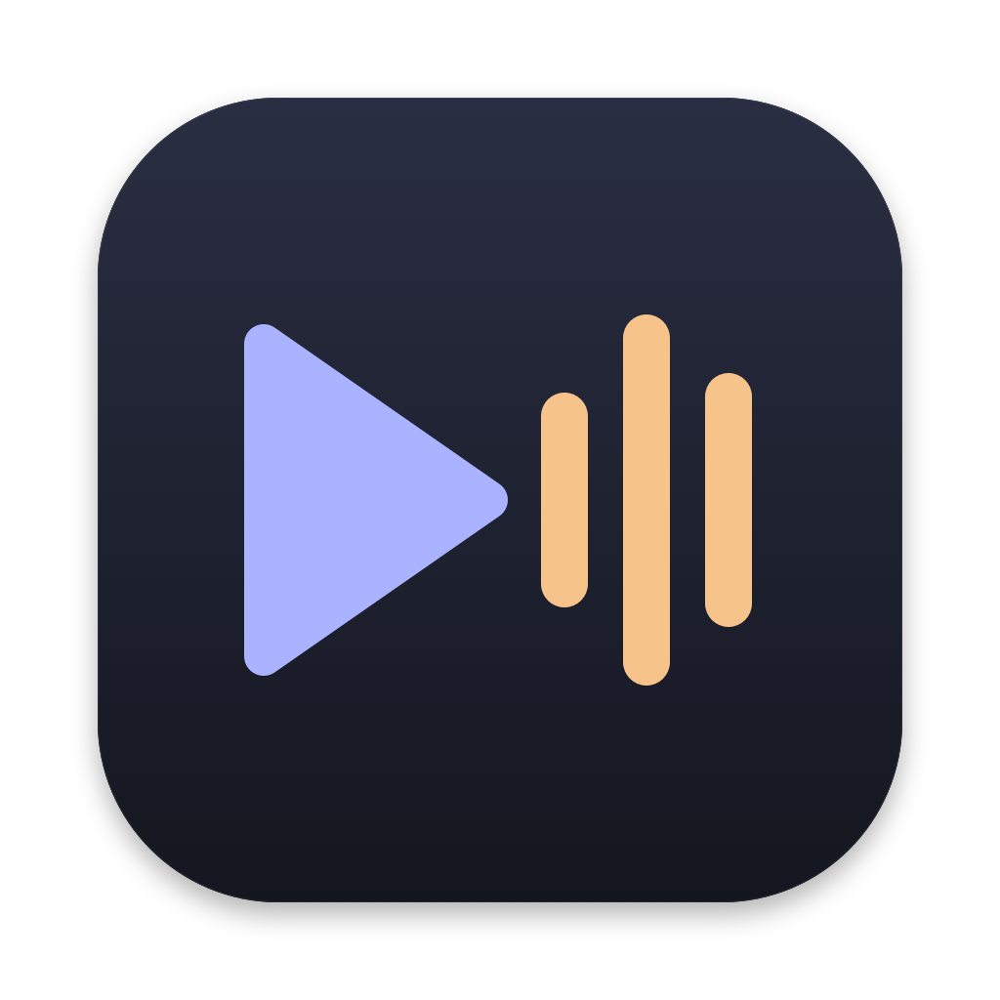
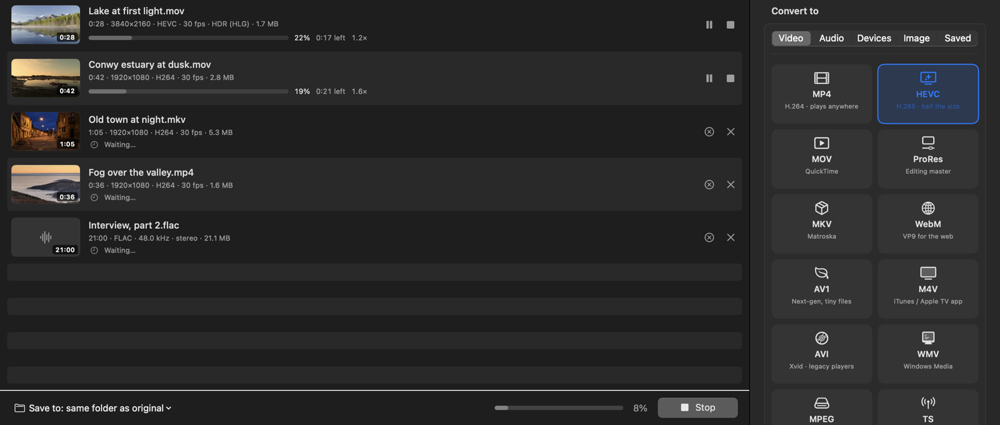

<p align="center">
  
</p>

<h1 align="center">Video &amp; Audio Converter</h1>

<p align="center">
  A free, native Mac app for converting video and audio.<br>
  No ads. No watermarks. No subscriptions. No "Pro" upgrade. Ever.
</p>

<p align="center">
  <a href="https://video-audio-converter-mu.vercel.app">Website</a> &nbsp;·&nbsp;
  <a href="https://github.com/ashrinkm/video-audio-converter/releases/latest">Download</a>
</p>

<p align="center">
  
</p>

---

## Why this exists

It started with something small: I needed to turn a few phone videos into a format my TV would play.

I searched the App Store for a video converter and spent the next hour downloading apps. Every one of them did the same thing. They let me drop in a file, then showed a paywall. Some stamped a watermark across the video. Some only converted the first few minutes. Others wanted a weekly subscription just to change MP4 to MOV.

What annoyed me most is that the hard part was already solved, and it was free. Almost all of these apps are wrappers around [FFmpeg](https://ffmpeg.org), an open-source project that thousands of volunteers have built over two decades. The apps were charging rent on work that was given away.

So I built the converter I was looking for: a clean, native Mac app that does the job and gets out of the way.

## Why it's free

Because it should be.

- **Converting a file is a solved problem.** FFmpeg already does the heavy lifting, and it's free. This app puts a friendly face on it, and it would be strange to charge for that.
- **No business model means no dark patterns.** There's nothing to upsell, so there's no reason to cripple features, nag you or hide things behind a paywall.
- **No tracking.** The app never connects to the internet. Your files stay on your Mac, and there are no accounts, analytics or telemetry.
- **It stays free.** The app is licensed under the GPL, so nobody can take it, close the source and sell it back to you.

If it saves you time, the best thanks is to star the repo, tell a friend, or file an issue when something breaks.

## Features

**Formats**
- **Video:** MP4 (H.264, HEVC, AV1), MOV, Apple ProRes, MKV, WebM (VP9, AV1), M4V, AVI, WMV, MPEG-2, TS
- **Audio:** MP3, M4A (AAC), Apple Lossless, FLAC, WAV, AIFF, OGG Vorbis, Opus, AC3, WMA
- **Images:** HEIC, JPEG, PNG, WebP and TIFF, including iPhone photos and RAW files
- **Animated GIF**, with high-quality palettes
- **Extract audio** from any video, or save a still frame or album artwork as an image
- Reads almost anything FFmpeg can open, including old camcorder files, phone recordings and obscure formats

**Presets**
- iPhone, iPad, Apple TV 4K, Android, YouTube, Instagram & TikTok, Web, Smart TV
- "Small" for email and chat, plus iPhone ringtones (.m4r)
- **Save your own presets** and reuse them with one click

**Fits where it needs to go**
- **Compress to a file size:** pick 10 MB for Discord, 16 MB for WhatsApp or 25 MB for email, and each file is squeezed to fit
- **iPhone HDR done right:** HDR videos are tone-mapped so they don't look washed out on normal screens, or kept as true 10-bit HDR when the format supports it
- **Merge** several clips or songs into one file, in the order you choose

**Edit before you convert**
- Visual trim with a filmstrip timeline and draggable start and end handles
- Crop with aspect presets (16:9, 9:16, 1:1, 4:3, 2.39:1), or remove black bars automatically
- Add subtitle files (SRT, ASS, WebVTT) as a track, or burn them into the picture
- Edit music tags (title, artist, album, year, genre, track) and album artwork
- Text or image watermark, with position, size and opacity
- Fade in and out, reduce video noise, reduce background hiss, stabilize shaky footage
- Playback speed from 0.25× to 4×, rotate, flip, deinterlace

**Control when you want it**
- Resolution: 4K down to 240p, or any custom size with letterboxing
- Frame rate, constant quality, target bitrate or target file size, encoder speed
- Audio codec, bitrate, sample rate, mono, stereo or 5.1, 16- or 24-bit
- Volume boost and loudness normalization (EBU R128)
- Pick which audio track to keep, or keep them all
- Remux without re-encoding when you only need a different container
- Keeps subtitles, metadata, chapters and album artwork

**Built for batches**
- Drag in files or whole folders, or right-click files in Finder and choose **Services → Convert with Video & Audio Converter**
- Several conversions run at once, with hardware acceleration
- Pause, resume or cancel any file, with live progress, time remaining and speed
- Keeps your Mac awake while it works, and notifies you when it's done
- Never touches your originals: saves next to the original or in a folder you choose
- **Copy FFmpeg Command** on any file, if you want to see exactly what's happening

## Install

Runs on any Mac with macOS 14 Sonoma or newer, Apple Silicon or Intel. Everything is included, so you don't need to install anything else.

### Download

Get the latest **[Video-Audio-Converter.dmg](https://github.com/ashrinkm/video-audio-converter/releases/latest)**, open it, and drag the app into Applications.

### Homebrew

```bash
brew tap ashrinkm/tap
brew trust ashrinkm/tap
brew install --cask video-audio-converter
```

> **First launch:** releases aren't notarized by Apple yet, so macOS will say it can't verify the app. Open it once, then go to **System Settings → Privacy & Security**, scroll down, and click **Open Anyway**. You only have to do this once.

### Build from source

```bash
git clone https://github.com/ashrinkm/video-audio-converter.git
cd video-audio-converter
./build.sh --install
```

This builds the app and copies it to `/Applications`. A source build uses the FFmpeg on your system (`brew install ffmpeg`). To build the self-contained version with FFmpeg included, run `scripts/release.sh <version>`; it compiles FFmpeg and its codecs from source for both Apple Silicon and Intel first, which takes 30–40 minutes the first time.

## How it works

The app is written in Swift and SwiftUI. It looks at each file with `ffprobe`, works out the best FFmpeg command for the format and settings you picked, and runs the conversions in the background while tracking their progress. The downloadable app ships with its own copy of FFmpeg, built from official sources (see [third-party licenses](docs/THIRD_PARTY.md)). You can point it at a different build in **Settings → Engine**.

## Contributing

Bug reports, format requests and pull requests are all welcome. If a file won't convert, please open an issue and include the output of **Copy FFmpeg Command** and the error message. That's usually enough to track it down.

## License

[GPL-3.0](LICENSE). Free to use, share and change, and it has to stay that way.

FFmpeg is a trademark of Fabrice Bellard and is developed by the [FFmpeg project](https://ffmpeg.org). This app is not affiliated with FFmpeg; it builds on their work.
